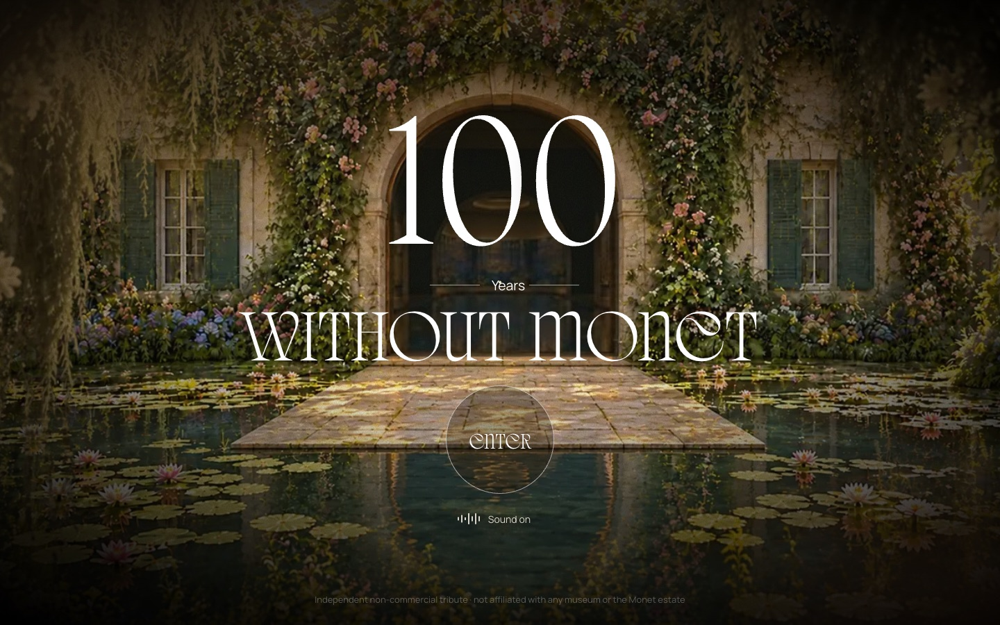

# Monet 100

**[100yearsmonet.com](https://100yearsmonet.com)** — an immersive WebGL tribute to Claude Monet, 100 years after his death.

Step through the door of the house at Giverny into a 3D garden of water lilies and walk through his paintings, with sound on.

**What I did:** concept, art direction, 3D scene, design and front-end — end to end, solo.

**How it's built**
- 3D scene modelled in Blender, lighting baked into lightmaps and exported to glTF
- Real-time WebGL in the browser, scroll-driven camera tour
- Ambient sound design, catalogue of the works

> This repository is a case study. The source code is private.

Independent non-commercial tribute, not affiliated with any museum or the Monet estate.

More work: [egor.digital](https://egor.digital)
